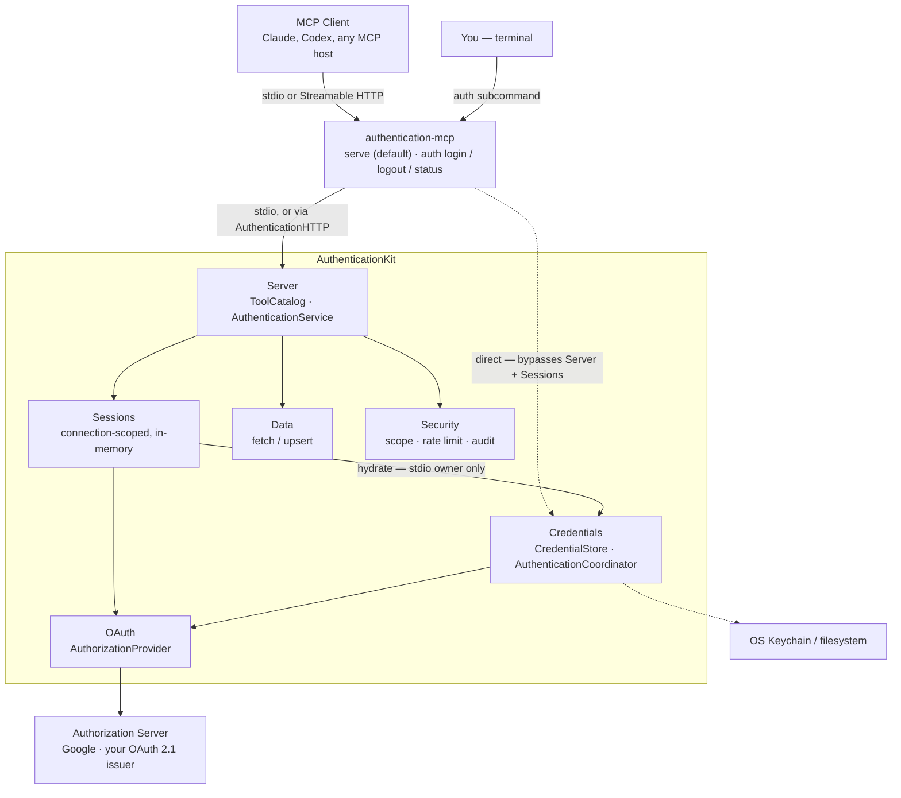
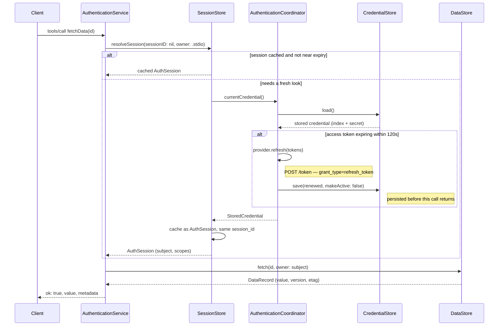
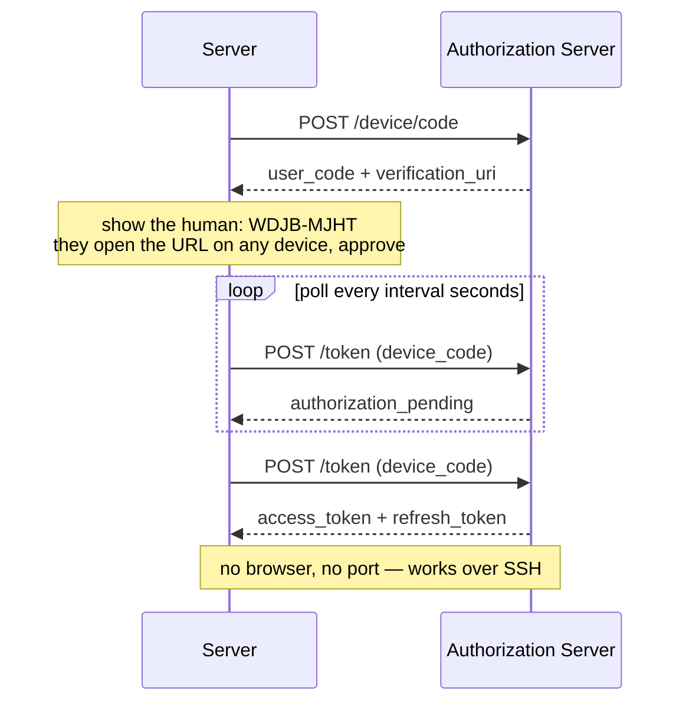
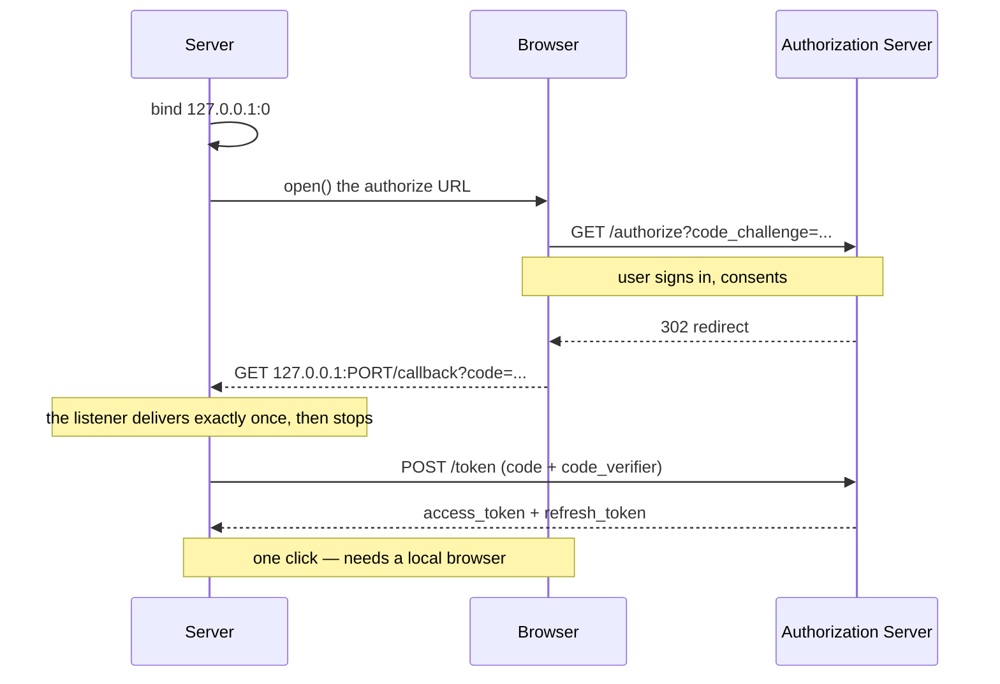
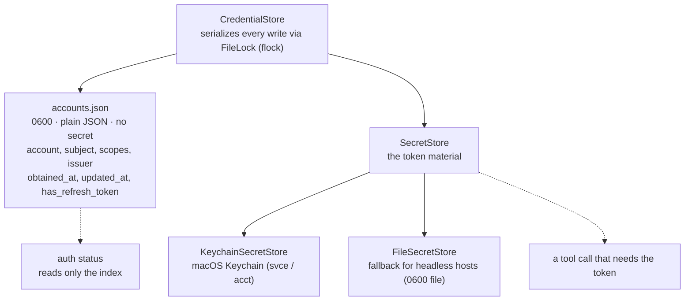
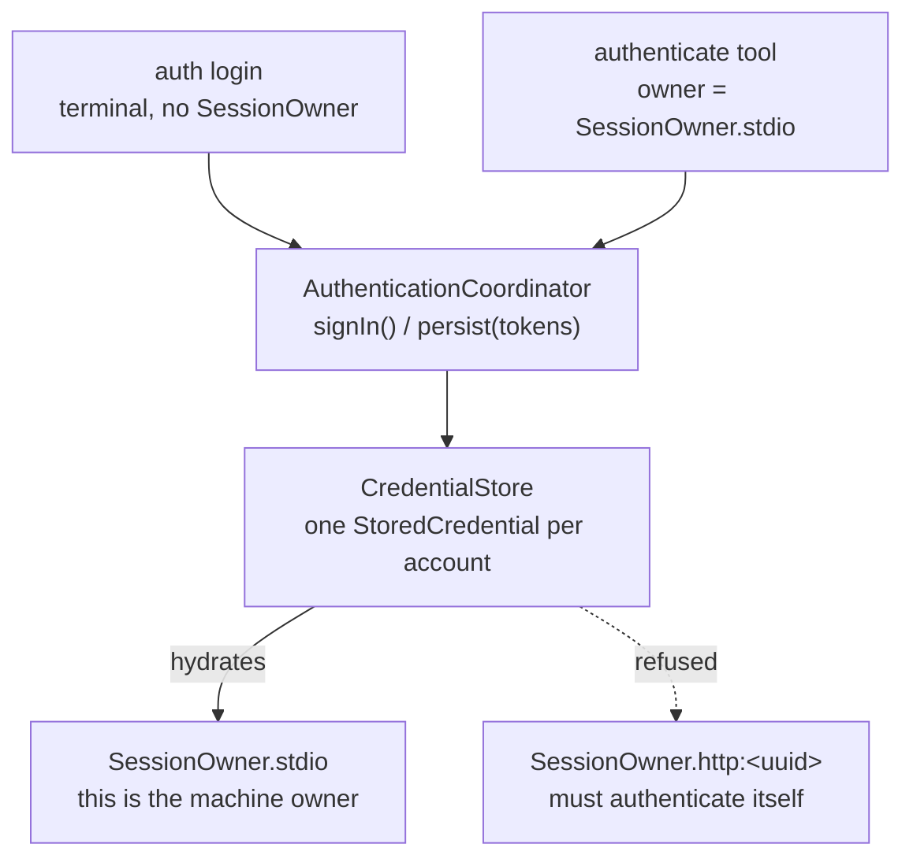
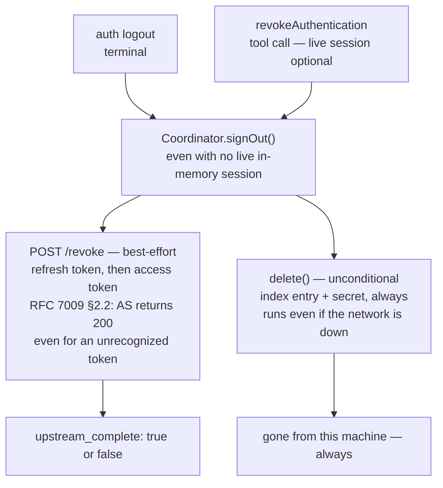
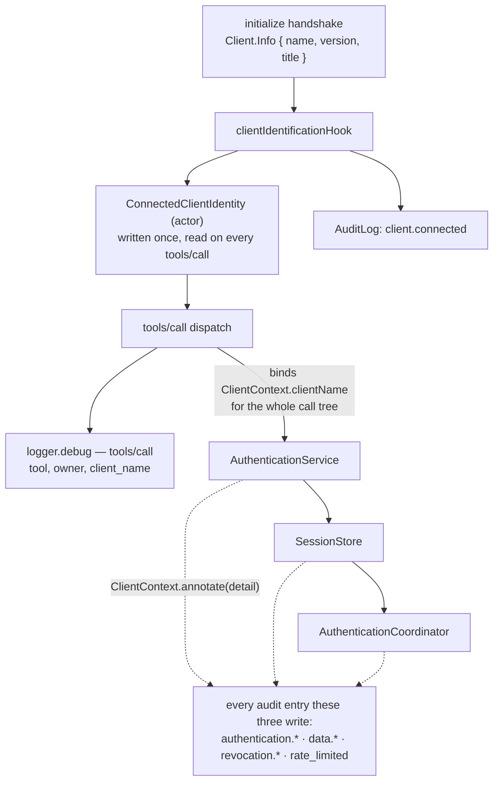

# Architecture

This document traces the real mechanisms behind `authentication-mcp` — where a
token lives, what happens on a refresh, and why a sign-in survives a restart
but not a `logout`. Each diagram is Mermaid, so it renders directly on this
page; nothing here is a static image to go stale next to the code.

If you haven't read it yet, [`README.md`](README.md) covers what the project
does and how to configure it, and [`LOCAL_NETWORK.md`](LOCAL_NETWORK.md) covers
serving it to other devices. This document covers *why it's built the way it
is*.

## Contents

- [Three targets, one shared core](#three-targets-one-shared-core)
- [What one `fetchData` call actually does](#what-one-fetchdata-call-actually-does)
- [Two ways to prove it's you](#two-ways-to-prove-its-you)
- [Why `auth status` never prompts for your keychain](#why-auth-status-never-prompts-for-your-keychain)
- [One store, two doors in, one door that's locked](#one-store-two-doors-in-one-door-thats-locked)
- [Sign-out is unconditional locally, best-effort upstream](#sign-out-is-unconditional-locally-best-effort-upstream)
- [Telling two MCP clients apart](#telling-two-mcp-clients-apart)
- [Directory layout](#directory-layout)

---

## Three targets, one shared core

Both entry points — a launched MCP client and you at a terminal — pass
through the same executable. What differs is which internal door they use:
tool calls go through session resolution; the `auth` subcommands reach the
credential store directly.



The line that surprises people: **`auth login`/`logout`/`status` never touch
[`AuthenticationService`](Sources/AuthenticationKit/Server/AuthenticationService.swift)
or [`SessionStore`](Sources/AuthenticationKit/Sessions/SessionStore.swift) at
all.** They talk straight to
[`AuthenticationCoordinator`](Sources/AuthenticationKit/Credentials/AuthenticationCoordinator.swift)
— the same object a tool call reaches indirectly through session resolution.
`Sessions` and `Credentials` both end up calling `OAuth`, but only one
connection owner — the stdio process — is allowed to hydrate a session from
the on-disk credential (see
[below](#one-store-two-doors-in-one-door-thats-locked)).

## What one `fetchData` call actually does

The interesting branch isn't the happy path — it's what happens when the
cached session is stale.
[`SessionStore`](Sources/AuthenticationKit/Sessions/SessionStore.swift)
decides, per call, whether to serve from memory, hydrate from disk, or
refresh upstream, and persists the result before the tool ever sees it.



The refresh branch only fires when the token is within 120 seconds of
expiring — see `TokenSet.shouldRefresh`. Everything below the first `alt` is
skipped on a warm call, which is what keeps repeated tool calls fast. The
rotated refresh token is written back to `CredentialStore` **before** this
call returns; losing it would lock the user out permanently the next time the
provider rotates it away.

The tool never sees a token — only a resolved `AuthSession`. The credential
lived and died inside this one call.

## Two ways to prove it's you

`AuthorizationMode.automatic` picks between these based on one fact: can this
process reach your browser? stdio says yes; a remote HTTP deployment says no.
Both terminate in the same place — an access token plus a refresh token — by
different roads, implemented by the same
[`OAuthAuthorizationProvider`](Sources/AuthenticationKit/OAuth/OAuthAuthorizationProvider.swift)
actor.

### Device grant — RFC 8628



### Authorization code + PKCE — RFC 7636 / 8252



The single-shot listener in
[`LoopbackRedirectListener.swift`](Sources/AuthenticationKit/OAuth/LoopbackRedirectListener.swift)
matters more than it looks: it accepts exactly one redirect and then stops,
so a stale listener from a cancelled sign-in can never be reused to smuggle in
a second authorization code.

## Why `auth status` never prompts for your keychain

Every write goes to both halves of
[`CredentialStore`](Sources/AuthenticationKit/Credentials/CredentialStore.swift);
most reads only need one. `gh` draws the same line — `hosts.yml` for the
account, a `gh:github.com` keychain item for the token.



`auth status` never prompts and never unlocks anything — it answers "who is
signed in?" from the plain JSON index alone. A tool call that actually needs
the token pays the cost of unlocking the keychain; nothing else does. If the
index names an account with no matching secret — a keychain wiped by hand,
say — `CredentialStore.load()` drops the orphaned entry rather than reporting
a sign-in it cannot back with a token.

## One store, two doors in, one door that's locked

A terminal `auth login` and the in-conversation `authenticate` tool write the
identical `StoredCredential`. But only `SessionOwner.stdio` — the process the
human is actually running — may ever read it back.



Handing a remote HTTP session the machine owner's Google identity would be a
privilege escalation, not a convenience — so
`SessionStore.persistedSession(owner:)` checks the owner before it ever reads
`CredentialStore`. Persistence for HTTP is off by default for the same
reason (`ServiceOptions.credentials`, set per-transport in
[`Command.swift`](Sources/AuthenticationMCPServer/Command.swift)).

## Sign-out is unconditional locally, best-effort upstream

The authorization server is required to answer `200` even for a token it has
never seen (RFC 7009 §2.2) — so a clean revocation response proves nothing.
The local delete happens regardless of what comes back; only the reported
`upstream_complete` flag tells you which one you got.



`revokeAuthentication` falls through to the stored credential even when the
calling connection never hydrated a session in memory — see
`SessionStore.signOutStoredCredential`. Earlier in this project that fallback
didn't exist: sign-out reported success while the credential sat untouched on
disk. It's now covered by a dedicated test
(`Persistent sign-in through the tools`, in
[`CredentialStoreTests.swift`](Tests/AuthenticationKitTests/CredentialStoreTests.swift)).

## Telling two MCP clients apart

stdio is strictly 1:1 — two clients on one machine are always two separate OS
processes, never one connection multiplexing two identities. What the process
boundary *doesn't* give you is a name for either one, and that matters for
logs and audit trails: "which integration made this call" is not answerable
from `SessionOwner` alone, since every stdio connection uses the same owner
label.

The MCP `initialize` handshake carries `Client.Info` — name, version, an
optional title — exactly once, before any tool call. The SDK's `Server` actor
keeps it as a private property with no getter afterward, so a hook at
connection time is the only place it can ever be observed.



Two things worth being precise about:

- **It's identification, not authentication.** `clientInfo.name` is whatever
  the client says it is, sent over an unauthenticated local pipe or HTTP
  session. It's useful for logs, audit trails, and per-client policy — never
  a security boundary. A client can put anything in that field.
- **`ClientContext.clientName` is a `@TaskLocal`, not a threaded parameter.**
  `AuthenticationCoordinator` sits three calls deep from tool dispatch, and
  it's also invoked directly by the standalone `auth` CLI, which has no MCP
  connection at all. Threading an explicit parameter through every
  intervening function would touch a dozen signatures for something that's
  really ambient context. Binding it once, around the whole dispatch, means
  every audit entry written anywhere in that call tree can attach it via
  `ClientContext.annotate(_:)` — and it correctly reads `nil`, omitting the
  field, for anything the CLI does directly. This mirrors how the SDK itself
  carries per-request context (`Server.currentHandlerContext`).

## Directory layout

```
Sources/
  AuthenticationKit/          Core: tools, OAuth client, sessions, credentials, data store
    OAuth/                    Discovery, PKCE, device grant, refresh, revocation
    Credentials/              Keychain/file credential store, sign-in coordinator
    Sessions/                 Connection-scoped session store
    Data/                     DataStore protocol and two implementations
    Server/                   Tool catalog, argument validation, error mapping, client identity
    Security/                 Scopes, rate limiting, audit log, redaction
    Support/                  JSON Schema DSL, Value helpers, timestamps, ClientContext
  AuthenticationHTTP/         NIO host for Streamable HTTP, Host/Origin allowlist
  AuthenticationMCPServer/    Executable: serve + auth subcommands
Tests/
  AuthenticationKitTests/     Unit, and end-to-end over InMemoryTransport; output-schema conformance
  AuthenticationHTTPTests/    HostAllowlist, checked against the SDK's own OriginValidator
```

Every collaborator in the diagrams above is a real type in this tree, not a
simplification — [`SessionStore.swift`](Sources/AuthenticationKit/Sessions/SessionStore.swift)
really is one file, and its `resolveSession` really does everything the
second sequence diagram shows.
