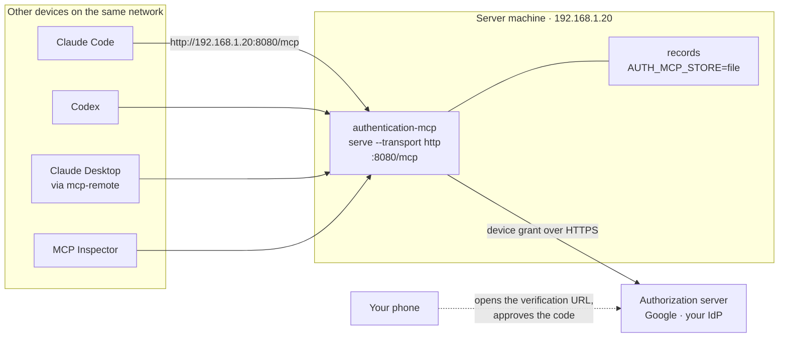
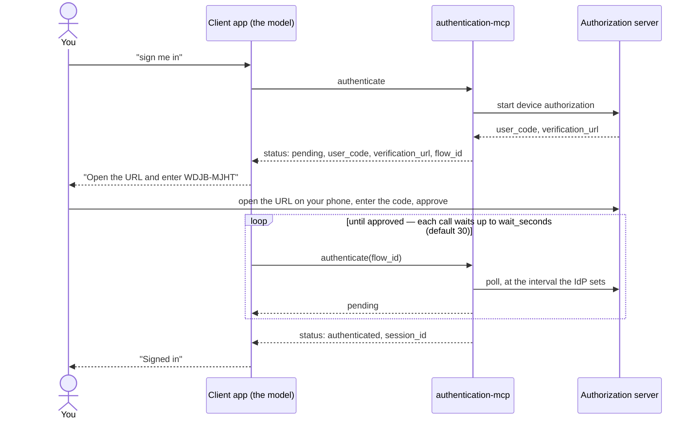

# Hosting on your local network

**Yes — the server can run on one machine and serve MCP clients on other
devices on the same network.** It uses the Streamable HTTP transport, which is
built in. This guide covers the whole flow: starting the server, connecting
Claude Code, Codex, Claude Desktop or the MCP Inspector by LAN address, signing
in, using the tools, and signing out.

It is a different experience from running the server locally over stdio, in a
few ways that are deliberate:

| | Local (stdio) | Over the network (HTTP) |
| --- | --- | --- |
| How sign-in works | Browser opens on your machine, or `auth login` once in a terminal | Device code: the client shows a short code, you approve it on any device |
| Does sign-in survive a restart? | Yes — stored in your keychain until `auth logout` | No — each client connection signs in, and is signed out when it disconnects |
| Can a client use the server owner's `auth login`? | It *is* the server owner | **Never** — that credential is not served over the network |
| Encrypted in transit? | Nothing leaves the machine | **No** — plain HTTP; see [Security](#security-on-a-shared-network) |



## Contents

1. [Before you start](#1-before-you-start)
2. [Run the server](#2-run-the-server)
3. [Connect a client](#3-connect-a-client)
4. [Sign in](#4-sign-in)
5. [Use it](#5-use-it)
6. [Sign out](#6-sign-out)
7. [Using a real identity provider](#7-using-a-real-identity-provider)
8. [Security on a shared network](#security-on-a-shared-network)
9. [Keeping it running](#keeping-it-running)
10. [Troubleshooting](#troubleshooting)

---

## 1. Before you start

- **Both devices are on the same network** — same Wi-Fi or wired LAN, and not a
  guest network that isolates clients from each other.
- **Build a release binary** on the server machine:

  ```bash
  swift build -c release
  ```

- **Find the server's address.** Any client will connect to it.

  ```bash
  ipconfig getifaddr en0          # macOS, Wi-Fi — usually en0
  hostname -I                     # Linux
  scutil --get LocalHostName      # macOS: <name>.local also works on most home networks
  ```

  An IP address can change when your router hands out a new lease. Either reserve
  it in your router's DHCP settings, or connect by the `.local` name instead.

- **Firewall.** If the macOS firewall is on (*System Settings → Network →
  Firewall*), the first time the server listens it will ask whether to accept
  incoming connections — allow it. A locally built, unsigned binary gets a new
  identity on every rebuild, so expect the prompt again after `swift build`.

- **Choose a provider for the first run.** Start with `AUTH_MCP_PROVIDER=mock`:
  it needs no account and signs everyone in as `mock-user-1`, so you can test the
  whole path end to end. Never leave the mock running on a network you share — see
  [Security](#security-on-a-shared-network). Moving to a real provider is
  [section 7](#7-using-a-real-identity-provider).

## 2. Run the server

**Recommended — bind the LAN address itself:**

```bash
AUTH_MCP_PROVIDER=mock \
AUTH_MCP_STORE=file \
AUTH_MCP_STORE_PATH="$HOME/.authentication-mcp/records" \
./.build/release/authentication-mcp serve --transport http --host 192.168.1.20 --port 8080
```

Binding one specific address makes the server accept only requests addressed to
that address — protection against DNS rebinding — with nothing else to
configure. `AUTH_MCP_STORE=file` keeps records across server restarts; the
default store is in memory and empties when the server stops.

**If clients will use the `.local` name, or the machine has several addresses**,
list every name clients connect with:

```bash
AUTH_MCP_ALLOWED_ORIGINS="mymac.local:8080" \
AUTH_MCP_PROVIDER=mock \
./.build/release/authentication-mcp serve --transport http --host 192.168.1.20 --port 8080
```

Entries can be written as `host:port` or as a URL (`http://mymac.local:8080`) —
both mean the same thing. The bound address is always accepted in addition to
whatever you list. Binding `--host 0.0.0.0` (every interface) also works, but
then you **must** set `AUTH_MCP_ALLOWED_ORIGINS`, or the check is switched off
entirely and the server warns at startup.

The default `--host 127.0.0.1` listens only on the machine itself — other devices
get *connection refused*. That is the safe default; changing it is what puts the
server on the network.

**Check the startup log.** It names the URL and every `Host` it accepts — the
first place to look if a client is refused:

```
2026-10-17T08:20:59+0600 info authentication-service: accepted_hosts=127.0.0.1:8080 localhost:8080 [::1]:8080 192.168.1.20:8080 url=http://192.168.1.20:8080/mcp version=1.0.0 [AuthenticationHTTP] MCP HTTP endpoint listening
```

**Check it from another device:**

```bash
curl http://192.168.1.20:8080/healthz
# {"status":"ok"}
```

`/healthz` answers whatever name you use, so if it works but MCP requests get
`HTTP 421`, the name you're connecting with is missing from the allowlist.

## 3. Connect a client

The endpoint for every client is the server's address plus `/mcp`:

```
http://192.168.1.20:8080/mcp
```

### Claude Code

```bash
claude mcp add --transport http authentication http://192.168.1.20:8080/mcp
```

Add `--scope user` to make it available in every project rather than only the
current one. `claude mcp list` checks the connection.

### Codex

```bash
codex mcp add authentication --url http://192.168.1.20:8080/mcp
```

This writes an `[mcp_servers.authentication]` entry with `url = …` to
`~/.codex/config.toml`. Codex asks you to approve before it calls `authenticate`
— approve it in the interactive session. In a non-interactive `codex exec` run
the approval policy is `never`, so that call is refused.

### Claude Desktop

Claude Desktop launches local servers from a config file, so it reaches a network
server through [`mcp-remote`](https://www.npmjs.com/package/mcp-remote), a small
bridge that runs locally and forwards to the URL. It needs Node.js.

Edit `~/Library/Application Support/Claude/claude_desktop_config.json` on macOS
(`%APPDATA%\Claude\claude_desktop_config.json` on Windows):

```json
{
  "mcpServers": {
    "authentication": {
      "command": "npx",
      "args": ["-y", "mcp-remote", "http://192.168.1.20:8080/mcp", "--allow-http"]
    }
  }
}
```

Then restart Claude Desktop. `--allow-http` is required: without it `mcp-remote`
refuses any plain-`http` address that isn't `localhost`. The bridge passes the
client's real name through, so the server's logs still show which app connected.

The same pattern works for any client that can only launch local stdio servers.

### MCP Inspector

The official Inspector is the quickest way to see the tools and try them by hand:

```bash
npx @modelcontextprotocol/inspector
```

In the page that opens, choose **Streamable HTTP**, enter the URL, and connect.
It also has a command-line mode:

```bash
npx @modelcontextprotocol/inspector --cli http://192.168.1.20:8080/mcp \
    --transport http --method tools/list
```

Each `--cli` invocation is a fresh connection, so a sign-in from one command
doesn't carry over to the next — use the browser UI to sign in and then use the
tools in one session.

## 4. Sign in

Over the network the server can't open a browser on *your* device, so sign-in
always uses the **device grant**: the client gets a short code and a URL, you
approve on any device with a browser, and the client polls until you're done.
In a chat client you just ask — "sign me in to authentication" — and the model
drives this:



A few things worth knowing:

- **Polling is paced for you.** Each `authenticate` call with a `flow_id` waits up
  to `wait_seconds` before answering `pending`, and the server polls the identity
  provider no faster than the interval it asks for. A person taking a minute to
  type a code on their phone is the normal case.
- **The mock provider approves immediately**, so you won't see the pending step.
  To rehearse what a real provider feels like, start the server with
  `AUTH_MCP_MOCK_POLICY=delay:15` — sign-in then stays pending for 15 seconds.
- **A fixed redirect URI needs the hand-off flow instead.** If the identity
  provider only has a custom-scheme redirect registered for your client
  (`myapp://callback`), the device grant may not be on offer. Set
  `AUTH_MCP_OAUTH_REDIRECT_URI` on the server and add the
  [redirect-capture](Tools/redirect-capture) tool to the client machine; the
  model then signs in with `authenticate(mode: "handoff")`.
- **Each connection signs in separately.** A sign-in belongs to one client
  connection. It is not shared with other devices, and not with `auth login` on
  the server machine.
- **Disconnecting signs you out.** When a client disconnects — or after an hour
  with no requests (`AUTH_MCP_HTTP_SESSION_TIMEOUT`, in seconds) — the server
  revokes that connection's tokens. Restarting the client app means signing in
  again. This is intentional: tokens are never left behind for a connection no
  one is using.

## 5. Use it

Once signed in, ask in plain language. The model chooses the tools:

| You say | The client calls |
| --- | --- |
| "Save a note called `groceries` saying eggs, milk" | `updatedData(id: "groceries", value: {…})` |
| "What's in `groceries`?" | `fetchData(id: "groceries")` |
| "Add bread to `groceries`, but don't overwrite anyone else's change" | `fetchData`, then `updatedData` with `expected_version` |
| "Sign me out" | `revokeAuthentication` |

**Records belong to whoever signed in.** Sign in as the same account on your
laptop and your tablet and both see the same records; someone signed in as a
different account sees none of yours. Under the mock provider everyone is
`mock-user-1`, so all devices share one set of records.

**Concurrent edits from two devices are guarded** if the client passes the
`version` it last read as `expected_version`: the second write fails with
`version_conflict` instead of silently overwriting the first, and the error says
which version is current.

## 6. Sign out

Ask the client to sign you out, or let it disconnect. `revokeAuthentication`
asks the identity provider to revoke the tokens and always discards them on the
server, even if the provider can't be reached — its result says whether the
provider confirmed (`upstream_complete`). It's safe to call twice.

## 7. Using a real identity provider

The flow above is the same with a real provider; only the sign-in screen changes.
Because network clients always use the device grant, **your provider must support
it** (RFC 8628). The server finds the device endpoint through the provider's
discovery document; if the provider doesn't publish one, set
`AUTH_MCP_OAUTH_DEVICE_ENDPOINT`. See the [README](README.md#configuration) for
every setting.

**With Google**, the device grant needs an OAuth client of type *TVs and Limited
Input devices* — the *Desktop app* client that works for `auth login` won't do
device sign-in — and Google allows only a limited set of scopes through it.
Create the client under *APIs & Services → Credentials*, and check Google's
current list of scopes allowed for the device flow before you rely on one.

```bash
AUTH_MCP_PROVIDER=google \
AUTH_MCP_GOOGLE_CLIENT_ID=123…apps.googleusercontent.com \
AUTH_MCP_GOOGLE_CLIENT_SECRET=GOCSPX-… \
AUTH_MCP_OAUTH_SCOPES="openid,email" \
./.build/release/authentication-mcp serve --transport http --host 192.168.1.20 --port 8080
```

## Security on a shared network

| Risk | Protected? |
| --- | --- |
| Another device reading your records | **Yes** — records belong to the signed-in account, and sessions to the connection that signed in |
| Another device using the server owner's `auth login` | **Yes** — that stored credential is only ever used by a local stdio client |
| A web page reaching the server through DNS rebinding | **Yes**, while the `Host` allowlist is active — bind a specific address, or set `AUTH_MCP_ALLOWED_ORIGINS` |
| Any device on the network connecting and starting a sign-in | **No, by design** — there is no password on the endpoint itself. Starting sign-ins is rate-limited, and a device still can't see anything without signing in |
| Someone watching network traffic | **No** — see below |
| Anyone signing in under the mock provider | **No** — everyone becomes `mock-user-1`. Use the mock only on a network you control |

**Traffic is not encrypted.** The server speaks plain HTTP. Access tokens never
cross the network — they stay on the server — but record contents do, and so does
the `MCP-Session-Id` header. Anyone who can read your network traffic could copy
a signed-in session's id and act as that session until it ends. On a home network
you trust, that may be acceptable. Otherwise, put encryption in front:

- **A TLS-terminating reverse proxy** (Caddy, nginx) on the server machine, with
  the server left on `127.0.0.1`. Add the proxy's public name to
  `AUTH_MCP_ALLOWED_ORIGINS` — the proxy forwards the original `Host` header,
  which the server checks. An entry with no port, such as `mymac.local`, matches
  the default HTTPS port. Clients must trust the proxy's certificate.
- **An SSH tunnel**, if the server machine allows remote login. On the client
  device run `ssh -N -L 8080:127.0.0.1:8080 you@mymac.local` and connect to
  `http://127.0.0.1:8080/mcp`. The server stays on its default loopback address,
  so no allowlist is needed.

> These two setups follow from how the server checks requests, but they were not
> tested end to end while writing this guide — the machine used had no proxy
> installed and remote login turned off. Everything else here was.

## Keeping it running

To start the server at login and restart it if it exits on macOS, save this as
`~/Library/LaunchAgents/io.github.ksypinro.authentication-mcp.plist`, replacing
the paths and address:

```xml
<?xml version="1.0" encoding="UTF-8"?>
<!DOCTYPE plist PUBLIC "-//Apple//DTD PLIST 1.0//EN" "http://www.apple.com/DTDs/PropertyList-1.0.dtd">
<plist version="1.0">
<dict>
    <key>Label</key>
    <string>io.github.ksypinro.authentication-mcp</string>
    <key>ProgramArguments</key>
    <array>
        <string>/Users/you/authentication-mcp/.build/release/authentication-mcp</string>
        <string>serve</string>
        <string>--transport</string>
        <string>http</string>
        <string>--host</string>
        <string>192.168.1.20</string>
        <string>--port</string>
        <string>8080</string>
    </array>
    <key>EnvironmentVariables</key>
    <dict>
        <key>AUTH_MCP_PROVIDER</key>
        <string>mock</string>
        <key>AUTH_MCP_STORE</key>
        <string>file</string>
        <key>AUTH_MCP_STORE_PATH</key>
        <string>/Users/you/.authentication-mcp/records</string>
    </dict>
    <key>RunAtLoad</key>
    <true/>
    <key>KeepAlive</key>
    <true/>
    <key>StandardErrorPath</key>
    <string>/Users/you/Library/Logs/authentication-mcp.log</string>
</dict>
</plist>
```

```bash
launchctl bootstrap gui/$(id -u) ~/Library/LaunchAgents/io.github.ksypinro.authentication-mcp.plist
tail -f ~/Library/Logs/authentication-mcp.log      # the server logs to stderr
launchctl bootout gui/$(id -u)/io.github.ksypinro.authentication-mcp   # stop it
```

Secrets such as `AUTH_MCP_GOOGLE_CLIENT_SECRET` in a plist are readable by any
process running as you. That is the same exposure as a `.env` file; if it matters,
keep them out of the file and start the server from a script that reads them from
the keychain.

## Troubleshooting

| Symptom | Likely cause | Fix |
| --- | --- | --- |
| *Connection refused* | The server is on its default `127.0.0.1`, or the address is wrong | Start with `--host <LAN address>`; re-check the address with `ipconfig getifaddr en0` |
| Times out, no reply | Firewall, or the devices aren't on the same network (guest Wi-Fi often isolates devices) | Allow the binary in the firewall; join the same network |
| `HTTP 421 Misdirected Request` | The name the client uses isn't in the allowlist | Compare with `accepted_hosts` in the startup log; add the name to `AUTH_MCP_ALLOWED_ORIGINS` |
| `HTTP 403 Origin not allowed` | A browser-based client on a name not in the allowlist | Same fix as 421 |
| `HTTP 404 Session not found` | The server restarted, or the session timed out | Reconnect the client — it starts a new session |
| `not_authenticated` after reconnecting | Expected: each connection signs in separately | Sign in again |
| `rate_limited` when signing in | Several new sign-ins started in quick succession | Wait the `retry_after_seconds` given, then resume the existing flow with its `flow_id` instead of starting another |
| Sign-in never completes with Google | The OAuth client isn't the *TVs and Limited Input devices* type | Create one of that type for network use |
| `mcp-remote`: *Non-HTTPS URLs are only allowed for localhost…* | `--allow-http` is missing | Add it to the `args` |
| Codex: *MCP tool call requires approval* | A non-interactive run with approval policy `never` | Use the interactive session and approve the call |

## How this guide was checked

Every step outside the [encryption section](#security-on-a-shared-network) was run
against this build, over a real LAN address, with the mock provider: the
`Host`-check behavior for each way of binding, a full session (device sign-in
held pending for 12 seconds, writes, reads, a second client kept out, sign-out),
and connections from MCP Inspector 2.11.0, `mcp-remote`, Claude Code 2.1.287 and
Codex 0.159.0. With Claude Code and Codex, the connection and handshake were
confirmed from the server's side; a model then calling the tools was not
exercised end to end.

Testing it this way found and fixed three bugs that had kept clients from
working over the network:

- **`AUTH_MCP_ALLOWED_ORIGINS` could never work.** The same list was checked
  against both the `Host` header (no scheme) and the browser `Origin` header
  (with scheme), so every value was rejected by one check or the other.
- **The server advertised a `logging` capability it doesn't implement.** The MCP
  Inspector calls `logging/setLevel` right after connecting and gave up when that
  failed.
- **Every successful tool result failed its own declared output schema**, which
  clients built on the TypeScript SDK check, rejecting the result. A test now
  validates every tool's real results against its schema.

It also changed sign-in polling: resuming a pending sign-in no longer counts
against the limit on starting one, and each poll now waits its full
`wait_seconds` rather than answering `pending` immediately — before, a client
could spin through thousands of calls while you typed the code.
